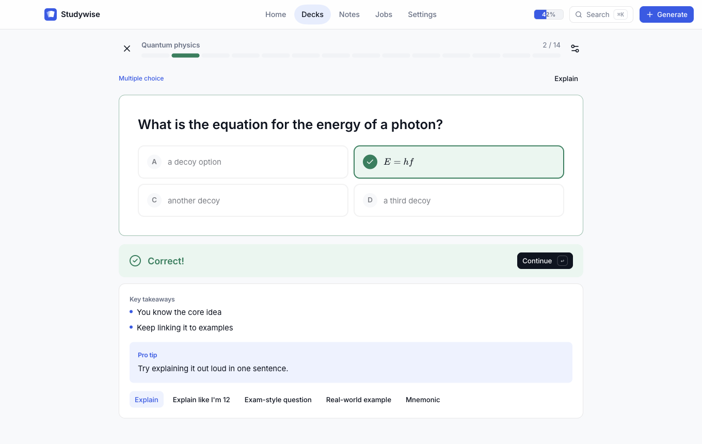

# Studywise Courses

A course, flashcard and notes app for Mac and Windows.

Make a course for a module, then add each week's slides, transcripts and readings. Claude splits every week into topics and teaches each one in short sections: a screen of notes (with the slide's figure if it helps), a few quick questions, then the next bit. Each topic has a separate test you take from the course page when you're ready, and leaves recall cards that pop up while you learn other topics and in spaced review.

It also keeps everything from Studywise: give it a lecture PDF and it makes notes and flashcards, then quizzes you and marks your answers.

It uses Claude Code on your computer (you need a Claude account), or Ollama: its cloud models with an API key, or models on your own Ollama server. You can import Anki decks (`.apkg`) and study them like any other deck.


| | |
|---|---|
|  |  |
|  |  |

## Setup

Install Claude Code and log in:

```sh
npm install -g @anthropic-ai/claude-code
claude
```

Or use Ollama instead: open Settings → AI provider, pick Ollama, paste an API key from [ollama.com/settings/keys](https://ollama.com/settings/keys), then choose your models in Settings → Models.

Then build the app:

```sh
npm install
npm run dist       # Mac: release/Studywise-Courses.dmg
npm run dist:win   # Windows: release/Studywise-Courses-Setup.exe
```

The app isn't signed. On a Mac, right-click it and pick Open the first time. On Windows, click More info, then Run anyway.

## Development

```sh
npm run dev        # run the app
npm test           # unit tests
npm run test:e2e   # end-to-end test
```

Set `AI_MOCK=1` to use fake AI replies instead of Claude.

More detail is in [docs/how-it-works.md](docs/how-it-works.md).

Not affiliated with Anthropic or StudySmarter.
