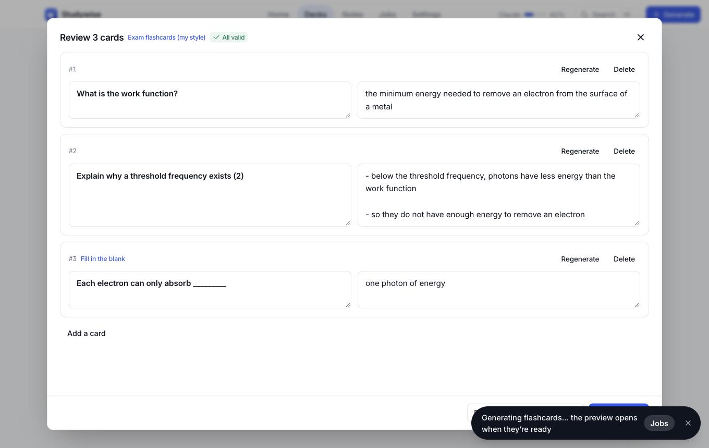

# Studywise

Flashcards, notes and revision for macOS and Windows, with Claude doing the tedious parts.

Drop in a lecture PDF and it writes notes in your style, turns them into exam-style flashcards, quizzes you with eight question types, marks what you write and explains what you got wrong. It reads the PDF itself, so tables, screenshots and diagrams count too.

The AI runs through [Claude Code](https://docs.anthropic.com/en/docs/claude-code) on your Mac, on your own Claude subscription. No API keys, no server.


| | |
|---|---|
|  |  |
|  |  |

## Install

You need Claude Code installed and signed in:

```sh
npm install -g @anthropic-ai/claude-code
claude   # sign in once
```

Then build it:

```sh
npm install
npm run dist       # Mac → release/Studywise.dmg (Apple silicon + Intel)
npm run dist:win   # Windows → release/Studywise-Setup.exe (x64), works from a Mac too
```

Neither build is code-signed. On a Mac, right-click the app and choose **Open** the first time (or run `xattr -dr com.apple.quarantine /Applications/Studywise.app`). On Windows, SmartScreen will warn: click **More info → Run anyway**. To sign and notarize the Mac build, set `CSC_LINK`, `CSC_KEY_PASSWORD`, `APPLE_ID`, `APPLE_APP_SPECIFIC_PASSWORD` and `APPLE_TEAM_ID` before building.

## Develop

```sh
npm run dev        # hot reload
npm test           # unit tests
npm run test:e2e   # Playwright smoke test
npm run ai:smoke   # check the Claude bridge
```

`AI_MOCK=1` swaps every AI call for canned output.

## More

[How it works](docs/how-it-works.md) covers the Claude bridge, models and prompts, Learn mode, spaced repetition, import/export formats, shortcuts and where your data lives.

Each person uses their own Claude login and subscription, subject to [Anthropic's terms](https://www.anthropic.com/legal/consumer-terms). Not affiliated with Anthropic or StudySmarter.
