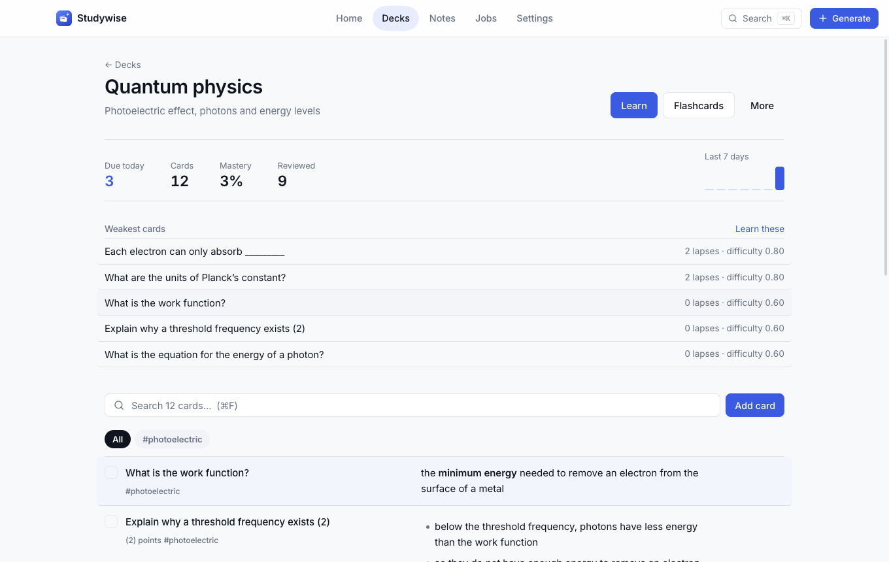

# Studywise

A flashcard and notes app for Mac and Windows.

You give it a lecture PDF. It makes notes and flashcards from it, then quizzes you and marks your answers.

It uses Claude Code on your computer, so you need a Claude account.


| | |
|---|---|
|  |  |
|  |  |

## Setup

Install Claude Code and log in:

```sh
npm install -g @anthropic-ai/claude-code
claude
```

Then build the app:

```sh
npm install
npm run dist       # Mac: release/Studywise.dmg
npm run dist:win   # Windows: release/Studywise-Setup.exe
```

The app isn't signed. On a Mac, right-click it and pick Open the first time. On Windows, click More info, then Run anyway.

## Development

```sh
npm run dev        # run the app
npm test           # unit tests
npm run test:e2e   # end-to-end test
```

Set `AI_MOCK=1` to use fake AI replies instead of Claude.

More detail is in [docs/how-it-works.md](docs/how-it-works.md).

Not affiliated with Anthropic or StudySmarter.
