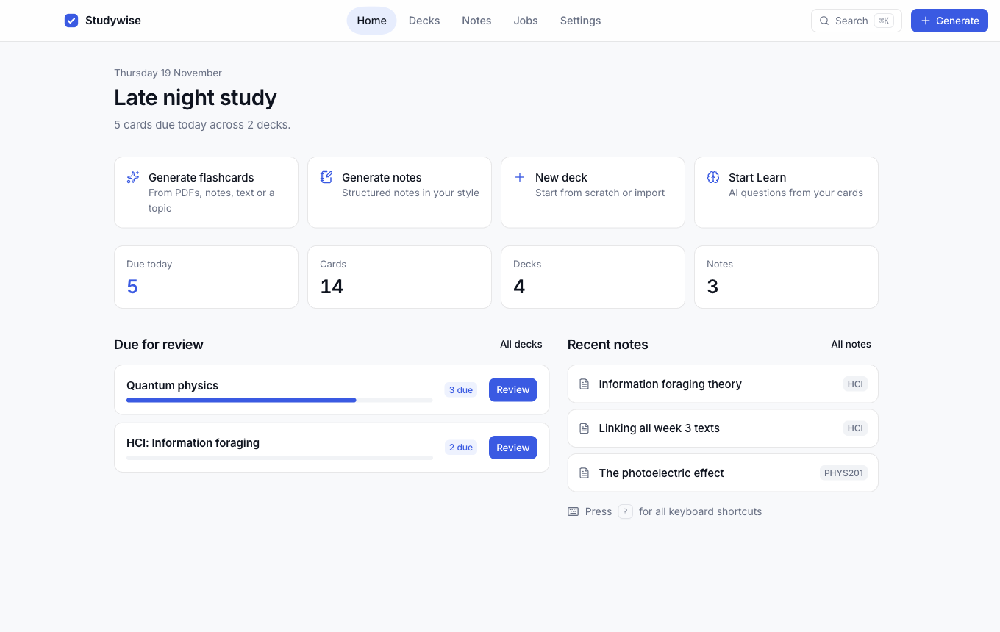
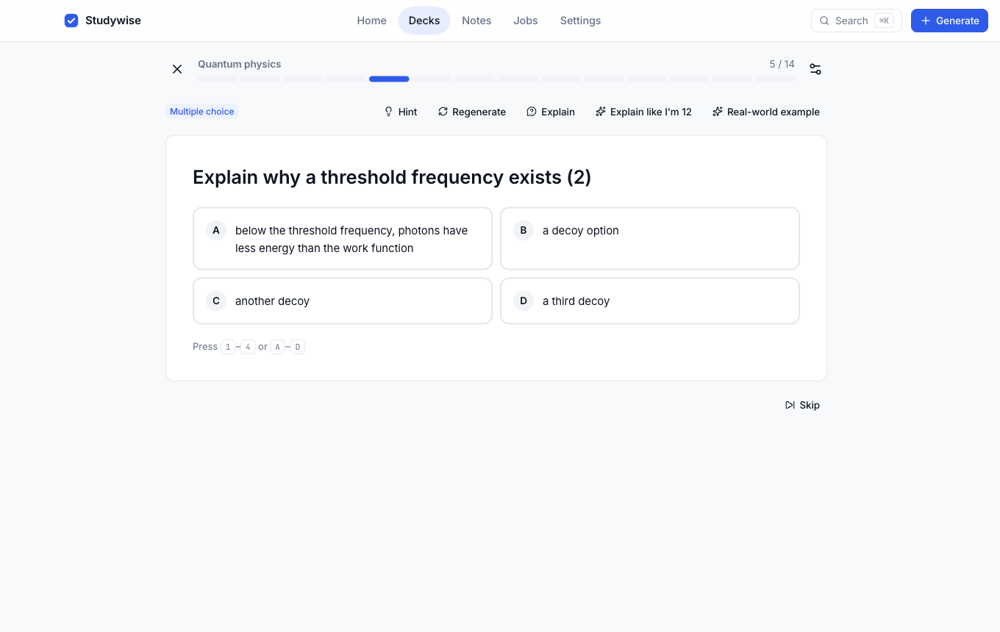
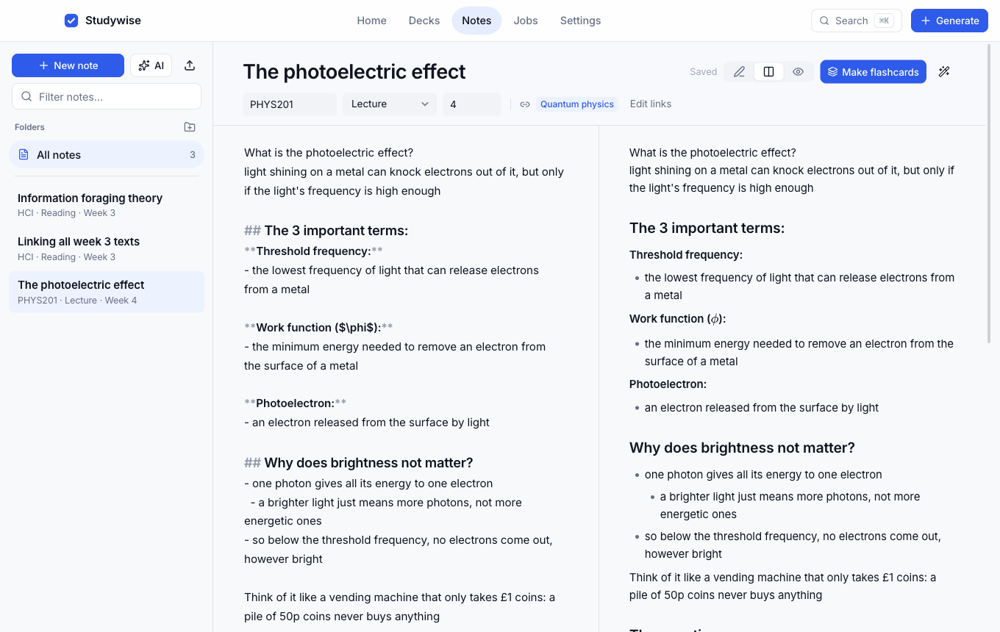
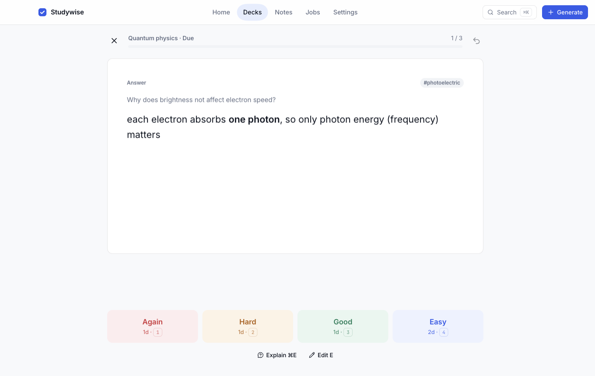
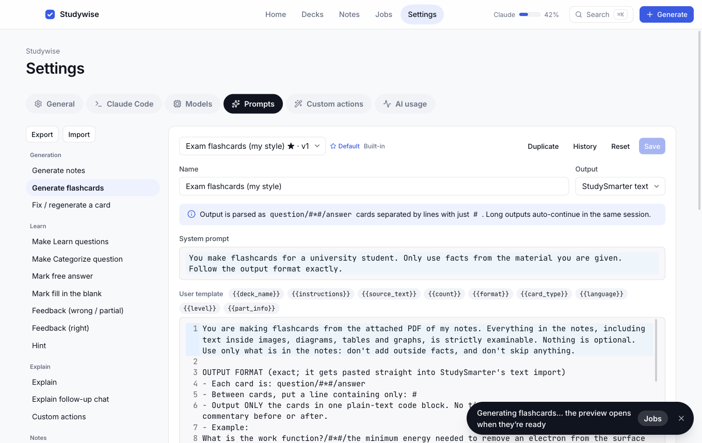
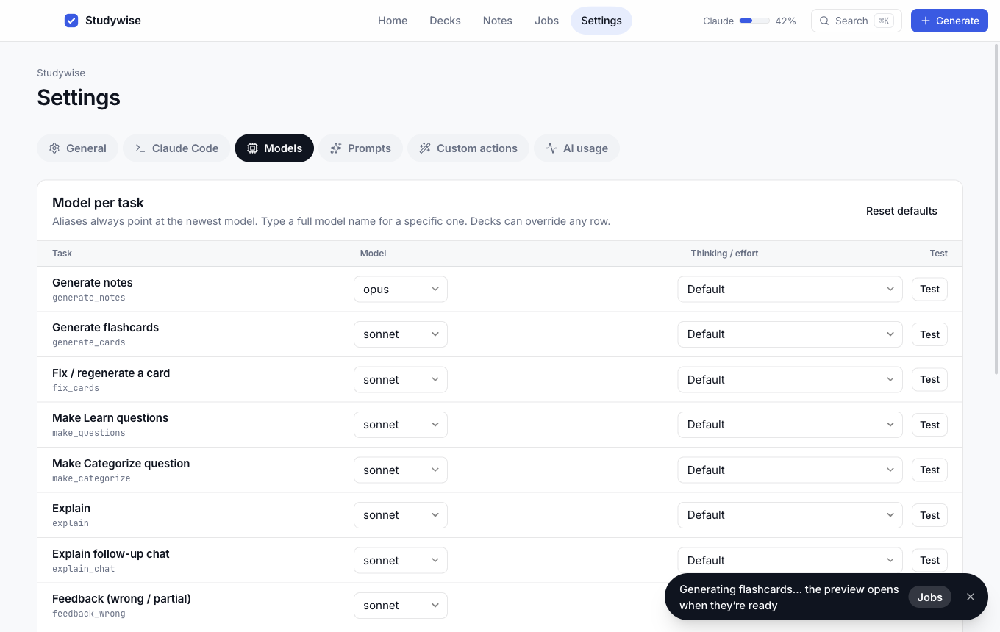
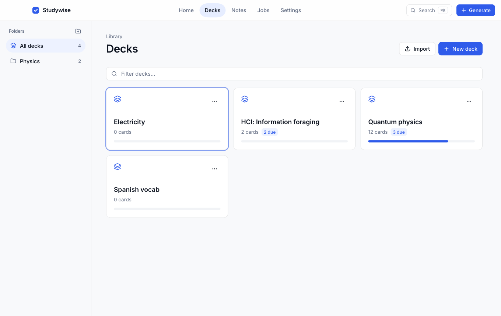
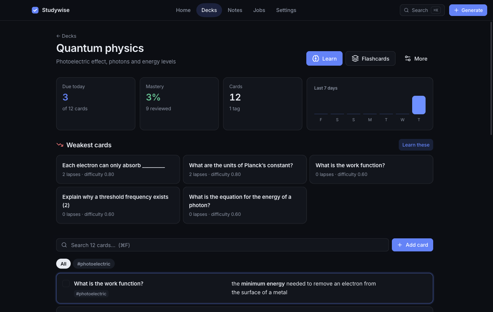

# Studywise

A flashcard, notes and revision app for macOS where the AI does the tedious parts. Drop in a lecture PDF and it writes your notes, turns them into exam-style flashcards, quizzes you with eight kinds of question, marks your written answers and explains what you got wrong.

All of the AI runs through [Claude Code](https://docs.anthropic.com/en/docs/claude-code) on your own Mac, using your own Claude subscription. There are no API keys and no server. If `claude` works in your terminal, Studywise works.



## What the AI does

| Feature | What happens |
|---|---|
| **Notes from PDFs** | Claude reads the PDF itself, including tables, screenshots and diagrams, not just the extracted text, and writes structured notes in a casual, exam-focused style. Long PDFs are split into 8-page chunks and stitched back into one note, streamed into the editor as it's written. |
| **Linking notes** | Pick several readings and it writes a "how these texts connect" note: themes, agreements, disagreements. |
| **Flashcard generation** | Exam-style cards from files, notes, pasted text or just a topic. Output uses the StudySmarter text format, gets parsed and checked (point counts, blanks, duplicates), and long runs auto-continue in the same Claude session until the whole source is covered. |
| **Fix with AI** | Any card that fails a check (say "(3)" in the question but only two bullets) can be fixed or regenerated with one click. |
| **Learn mode** | Each card becomes an AI-written question: Read & understand, Multiple choice, Free answer, True or false, Match pairs, Categorize, Fill in the blank, Choice blank. Questions are made 8 at a time, cached, and the next batch is fetched before you need it. |
| **Marking** | Free answers are scored out of 10 against the card, with partial credit per required point and spelling ignored unless it changes the meaning. Fill-in-the-blank accepts synonyms and small typos. Every mark has an "I was right" override. |
| **Feedback & hints** | After each answer: why yours was wrong (about what *you* wrote), key takeaways, and a way to remember it. Hints nudge without giving the answer away. |
| **Explain** | On every card, every feedback panel and any text you highlight in a note: a streamed explanation with Simpler / Go deeper / Example / Diagram (Mermaid) / Why was I wrong, and a follow-up chat. Save it to the card or turn it into new cards. |
| **Note tools** | Select text, then Simplify, Expand, Shorten, Fix formatting, Make flashcards, or Quiz me. |
| **Custom actions** | Make your own AI buttons ("Explain like I'm 12", "Mnemonic", ...) and choose where they appear. |

Every prompt is editable in Settings, and every task can use a different model.

<table>
<tr><td></td><td></td></tr>
<tr><td></td><td></td></tr>
<tr><td></td><td></td></tr>
<tr><td></td><td></td></tr>
<tr><td></td><td></td></tr>
</table>

## Setup

You need macOS 12 or later, Node 22+ (only to build it), and Claude Code installed and logged in:

```sh
npm install -g @anthropic-ai/claude-code
claude          # sign in once, then quit
```

Then:

```sh
git clone https://github.com/SnakeLuck360GT/studywise.git
cd studywise
npm install
npm run dev     # app with hot reload
```

If `claude` isn't installed or isn't logged in, a banner at the top of the app says so and tells you what to run.

### Building the app

```sh
npm run dist          # universal (Apple silicon + Intel) build
npm run dist:arm64    # faster, Apple silicon only
```

This makes `release/Studywise.dmg` and `release/Studywise-mac.zip`. Open the dmg and drag Studywise into Applications.

**First launch of an unsigned build.** Without a Developer ID certificate the app is only ad-hoc signed, so macOS will block it the first time. Either right-click Studywise in Applications and choose **Open** (on newer macOS: try to open it once, then System Settings → Privacy & Security → **Open Anyway**), or run:

```sh
xattr -dr com.apple.quarantine /Applications/Studywise.app
```

**Signing and notarizing (optional).** If these are set when you run `npm run dist`, the build is signed with hardened runtime and notarized. If they aren't, both steps are skipped.

| Variable | |
|---|---|
| `CSC_LINK`, `CSC_KEY_PASSWORD` | Developer ID Application certificate (.p12 path or base64) and its password. `CSC_NAME` works too for a cert already in your keychain. |
| `APPLE_ID`, `APPLE_APP_SPECIFIC_PASSWORD`, `APPLE_TEAM_ID` | For notarization. |

## How it talks to Claude

Everything goes through one function, `runAI()` in `src/main/ai/`. For each call it:

- finds the task's prompt preset and model, fills in the template and adds the output format;
- runs `claude -p` (print mode) in a fresh empty temp folder, with the prompt on stdin, JSON output, no shell and no tools, plus `--json-schema` for structured tasks and `stream-json` for anything that streams;
- removes `ANTHROPIC_API_KEY` and similar variables from the environment so it always uses your Claude login and never bills an API account;
- for PDFs, copies just that file into the temp folder and allows only the read-only `Read` tool;
- validates the result with zod and retries once with the error if it doesn't fit;
- logs the task, preset version, model, time, tokens and result to Settings → AI usage.

Apps opened from Finder don't get your shell's `PATH`, so on startup Studywise runs your login shell once to read it, then also checks `~/.claude/local`, `~/.local/bin`, `/opt/homebrew/bin`, `/usr/local/bin` and npm's global bin. Settings → Claude Code shows what it found, with a **Choose…** override and **Re-check**.

Long jobs (notes and card generation) run in the main process. Close the window and they keep going (the app stays in the Dock). When one finishes in the background you get a notification. The Jobs page shows progress and can cancel a job, which kills the `claude` process.

## Model routing

Settings → Models has one row per task: model (`haiku`, `sonnet`, `opus`, or any full model name), effort level, and a Test button. Defaults:

- **opus**: note generation
- **sonnet**: card generation, Learn questions, explanations and chat, feedback, free-answer marking, custom actions
- **haiku**: fill-in-the-blank marking, hints, Simplify / Shorten / Fix formatting

Any deck can override any task in its deck settings, which also has "extra instructions" that get added to every prompt for that deck (for example "Use SI units" or "This is AQA A-level").

## Prompts and custom actions

Settings → Prompts lists every task and its presets. You can:

- edit the system prompt and template, with the task's `{{variables}}` one click away;
- see a live preview of exactly what Claude will receive, using sample values you can edit;
- test-run the unsaved prompt and see the raw reply next to what the app parsed from it;
- duplicate, make default, look at the version history with a diff, and reset built-ins.

For JSON tasks the output schema is added by the app, not the prompt, so editing a prompt can't break parsing. Your three own presets ("My notes", "Linking texts", "Exam flashcards (my style)") ship as the defaults, word for word.

Custom actions (Settings → Custom actions) have a name, a prompt template, a model, an output type (Markdown in the Explain panel, or new cards) and where to show them: on cards, on a note selection, on a Learn question, or after answering. Presets and actions export and import together as one JSON file.

## Spaced repetition

Two schedulers, switchable in Settings → General:

- **Difficulty-based (default).** Modelled on real scheduling data. Cards start at difficulty 0.60 with three fixed 1-day steps. After that, intervals grow fast (about 3, 8, 20, 115 and 280+ days) and shrink for harder cards. A card comes back after `interval × (0.694 − 0.187 × difficulty)` days, so harder ones return sooner. Successful reviews bring difficulty down, and forgetting a card puts it into relearning.
- **SM-2.** Classic SuperMemo: ease starts at 2.5, intervals go 1 → 6 → interval × ease.

Flashcard mode uses Again / Hard / Good / Easy, and Learn results feed the same schedule. The Dock badge shows how many cards are due today.

## Import and export

- **StudySmarter text (.txt)**: `question/#*#/answer`, cards separated by a line containing only `#`. A trailing `(n)` sets the number of required points, and `___` runs make a cloze card whose answers are the `- ` bullets. Import and export round-trip exactly.
- **StudySmarter Excel (.xlsx)**: Question, then Answer A–F, each followed by `answer is correct (TRUE if yes, FALSE if no)`, then Tags, Hints and Explanation (tags and hints are semicolon-separated). Flags can be TRUE/FALSE, `=TRUE()`, true/false or 1/0. A normal card exports as Answer A = TRUE.
- **Deck JSON and CSV.**
- **Notes**: Markdown files or a Notion export (.zip). Title, Module, Type and Week are kept when present. Export a note as Markdown. PDFs become notes through "Generate notes".

Drag PDFs, Word or PowerPoint files onto the window or the Dock icon, or use **Open With → Studywise** in Finder, to start generating notes or flashcards.

## Keyboard

There are a lot of shortcuts. Press `?` in the app to see them all, or `⌘K` to search for anything. The main ones:

| | |
|---|---|
| `⌘N` / `⇧⌘N` / `⌥⌘N` | new card / note / deck |
| `⌘G` / `⇧⌘G` | generate flashcards / notes |
| `⌘L` / `⌘Y` | start Learn / flashcards |
| `⌘E` | explain |
| `⌘F`, `⌘K` | search, command palette |
| `Space`, `1`–`4` | flip, rate |
| `↩` | submit / continue |
| `h`, `s`, `r` | hint, skip, "I was right" |
| `g d`, `g n`, `g s` … | jump to decks, notes, settings |
| `j` / `k`, `x`, `e` | move, select, explain in a card list |
| `⌘1`–`⌘4`, `⌘,` | switch pages |

## Your data

Everything lives in `~/Library/Application Support/Studywise/`: the SQLite database (`studywise.db`), pasted images (`attachments/`), a cache and logs (`logs/main.log`). Settings → General has **Show data folder in Finder**, plus **Back up** and **Restore**, which zip and unzip the whole library. Restoring keeps a copy of the database it replaces.

## Environment variables

| Variable | |
|---|---|
| `AI_MOCK=1` | Fake, deterministic output for every AI task. Used by the tests. Nothing calls Claude. |
| `STUDYWISE_DATA_DIR` | Use a different data folder (handy for testing). |
| Signing variables | See [Building the app](#building-the-app). |

## Development

```sh
npm run dev            # electron-vite with hot reload
npm run typecheck
npm test               # unit tests (vitest, AI_MOCK=1, runs inside Electron's Node)
npm run test:e2e       # builds, then a Playwright run: create deck, add cards, full Learn session
npm run ai:smoke       # proves the Claude bridge works: JSON, streaming, card text
npm run ai:real-check  # one real call per AI task, plus notes and cards from a 12-page PDF
npm run icons          # rebuild build/icon.icns from build/icon.svg
node scripts/screenshots.mjs [--dark]   # regenerate the README screenshots
```

Layout: `src/main` is the Electron main process (database, the Claude bridge, jobs, import/export, IPC). `src/preload` exposes `window.studywise.<area>.<method>()` to the page. `src/renderer` is the React UI. `src/shared` is code both sides use: types, the StudySmarter parser, the schedulers, marking and the keymap. The renderer is sandboxed with context isolation, a strict CSP and no remote content, and every IPC message is checked with zod.

## A note on Claude

Studywise doesn't include, collect, store or proxy anyone's Claude login. Each person who installs it uses their own `claude` install and their own Claude subscription, and that use is subject to [Anthropic's terms](https://www.anthropic.com/legal/consumer-terms). Studywise isn't affiliated with Anthropic or StudySmarter.
